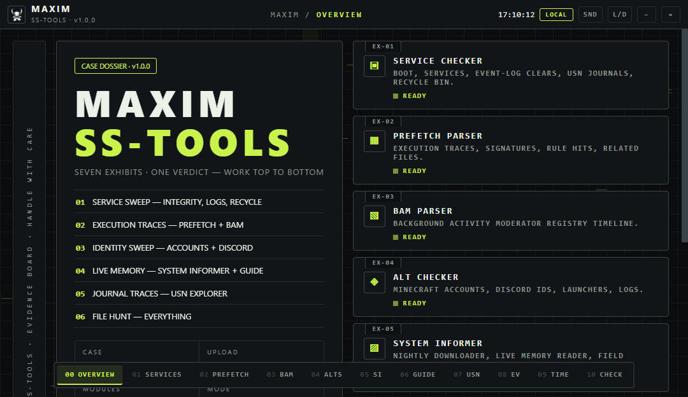

# Maxim SS-Tools

**A Windows tool for Minecraft evidence checks and system activity analysis**

Maxim SS-Tools is a Windows desktop application made to help users review system activity and check evidence related to Minecraft. It is built with C#, WPF, WebView2, and .NET 8, with a web-based interface.

## Transparency and Security

Maxim SS-Tools provides public source code so users and developers can see how the application works and review its features.

Users can check the source code to learn more about the application and how it handles system data. For safety, it is recommended to download the application only from official project releases.

## Preview



## Features

- Check Windows services, startup activity, drivers, and related system records.
- Review event logs, scheduled tasks, Recycle Bin activity, and leftover files.
- Parse Prefetch files to view execution counts, last-run times, and related file activity.
- Analyze BAM records to review application execution history and detect possible changes to entries.
- Check Minecraft accounts, launcher profiles, and Discord user IDs from available local data.
- Explore NTFS USN Journal records for file activity, including `.exe`, `.dll`, `.jar`, and `.pf` files.
- Use System Informer to review processes and related system activity.
- Use Everything to search for files and folders.
- Calculate SHA-256 hashes and capture screenshots to document findings.
- Export supported analysis results as JSON or CSV files.

Available information depends on the Windows version, system permissions, and the data present on the device. Some features may require downloading additional tools from their official sources.

## Analysis Modules

| ID    | Module                  | Description                                                                                                                                                                                            |
| ----- | ----------------------- | ------------------------------------------------------------------------------------------------------------------------------------------------------------------------------------------------------ |
| EX-01 | Service Checker         | Reviews Windows services, startup and driver activity, event log changes, USN Journal status, Recycle Bin activity, scheduled tasks, and leftover files. Supports JSON exports for individual modules. |
| EX-02 | Prefetch Parser         | Reads Windows Prefetch (`.pf`) files and displays execution counts, last-run times, rule matches, and related files.                                                                                   |
| EX-03 | BAM Parser              | Reviews Background Activity Moderator (BAM) records to examine application execution history and identify entries that may have been changed.                                                          |
| EX-04 | Alt Checker             | Checks Minecraft accounts and launcher profiles, including `.minecraft`, `.tlauncher`, Prism, and MultiMC data. Also reviews available Discord user IDs and related log evidence.                      |
| EX-05 | System Informer         | Supports downloading and launching System Informer, with guides for reviewing processes and selected system activity.                                                                                  |
| EX-06 | USN Explorer            | Searches the NTFS USN Journal for activity involving `.exe`, `.dll`, `.jar`, and `.pf` files. Supports drive selection, filters, and CSV exports.                                                      |
| EX-07 | Everything              | Supports downloading and launching Everything, opening folders, and searching for files by name.                                                                                                       |
| —     | Hash / Screenshot Tools | Calculates SHA-256 hashes for files and provides screenshot tools for documenting findings.                                                                                                            |

System Informer and Everything can be downloaded from their official sources when needed. See the Privacy and Network Activity section for more information.
## Requirements

- Windows 10 or Windows 11 (64-bit).
- .NET 8 Desktop Runtime, if not included with the application.
- Microsoft Edge WebView2 Runtime.
- Administrator permissions for some system checks.

## Building from Source

To build Maxim SS-Tools, you need Windows and the .NET 8 SDK.

Clone the repository:

```bash
git clone https://github.com/swqtmaxim/Maxim-SSTools.git
cd Maxim-SSTools
```

Open a terminal in the folder containing the required `.csproj` file and run:

```bash
dotnet publish -c Release -r win-x64 --self-contained false
```

This creates a build that requires the .NET Runtime to be installed.

To include the runtime with the application, run:

```bash
dotnet publish -c Release -r win-x64 --self-contained true
```

If the project includes a `build.ps1` script, you can use it to build the application.


## Privacy and Network Activity

Maxim SS-Tools is designed to review system information locally. Some features may connect to the internet to download additional tools or files.

Network activity and downloaded components may depend on the features being used. Users and developers can review the source code, dependencies, and application behavior to better understand how data is handled.
